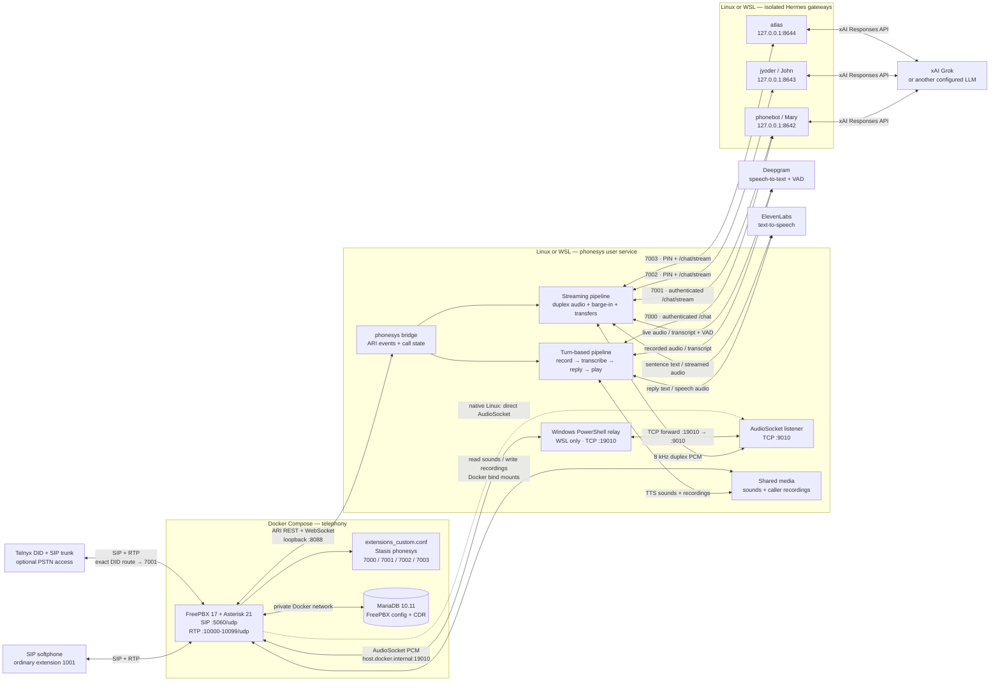

# FreePBX + Hermes telephone assistants

Deploy a Dockerized FreePBX/Asterisk PBX with a Python voice bridge and three
isolated [Hermes Agent](https://github.com/NousResearch/hermes-agent) profiles.
Callers speak to an assistant over SIP or an optional Telnyx DID; Deepgram
transcribes speech, Hermes runs the selected LLM, and ElevenLabs synthesizes the
reply.

The default routes are:

| Extension | Hermes profile | Mode | Access |
|---|---|---|---|
| 7000 | `phonebot` (Mary) | Turn-based fallback | Internal/public receptionist |
| 7001 | `phonebot` (Mary) | Streaming with barge-in and transfers | Main receptionist route |
| 7002 | `jyoder` (John) | Streaming | PIN required |
| 7003 | `atlas` | Streaming, optional consent-based hold | PIN required |

## Architecture



ARI controls calls; RTP carries phone audio. Extension 7000 exchanges recordings
and synthesized sound files through shared media, while 7001–7003 use
AudioSocket for streaming PCM. The bridge maps each extension to one Hermes base
URL and bearer-token environment variable; each profile's `API_SERVER_KEY`
matches its corresponding bridge `HERMES_*_API_KEY`. Each Hermes profile owns
its model login, sessions, and tools. On native Linux, Asterisk connects directly
to the bridge's container-reachable AudioSocket address; the Windows relay is
not needed.

## Prerequisites

- Debian/Ubuntu Linux, or WSL2 with systemd and Docker Desktop integration.
- Docker with Compose v2; Python 3.11+; `git`, `curl`, `ffmpeg`, and `uv`.
- A funded Deepgram account and an ElevenLabs account with access to the
  configured voices.
- An xAI account for the Grok example below, or another Hermes-supported LLM.
- Optional for public phone calls: a Telnyx account, voice-capable DID, and SIP
  connection. Internal extension testing does not need a carrier.

Keep the checkout and credentials on Linux storage, not `/mnt/c`. Run as the
intended service user, not root. The PBX image is a third-party image, not an
official Sangoma appliance. Restrict SIP/RTP with host/network firewalls before
exposing them; the no-fail2ban variant does not replace network controls.

## 1. Clone and install Hermes

```bash
git clone https://github.com/hoyack/phonebot-deployment.git
cd phonebot-deployment
export REPO=$(pwd -P)

# Official Hermes installation command for Linux, macOS, and WSL2:
curl -fsSL https://hermes-agent.nousresearch.com/install.sh | bash
export PATH="$HOME/.local/bin:$PATH"
hermes --version
export HERMES_BIN=$(readlink -f "$(command -v hermes)")
```

For a minimal telephone-only installation, the reviewed-installer variant and
compatibility checks are in [docs/SETUP.md](docs/SETUP.md). Hermes and the bridge
have separate Python environments; do not install one into the other.

Install the bridge's locked dependencies and run the offline tests:

```bash
(cd "$REPO/phonesys" && uv sync --frozen --extra dev --python 3.11)
"$REPO/phonesys/.venv/bin/python" -m pytest -q "$REPO/phonesys/tests" -m 'not live'
"$REPO/phonesys/.venv/bin/python" -m pytest -q "$REPO/tests_deployment"
python3 -m unittest discover -s "$REPO/freepbx" -p 'test_*.py'
```

## 2. Prepare a fresh FreePBX Docker deployment

This Compose project pulls upstream FreePBX and MariaDB images; there is no
local PBX Dockerfile to build. The following is the direct fresh-install path.
For a separate, digest-pinned PBX project generated outside the checkout, use
`python3 scripts/deploy.py pbx --help` and the
[short deployment guide](docs/free-pbx-deploy.md).

**Do not run fresh-install commands over an existing PBX or its volumes.**

```bash
cd "$REPO"
cp freepbx/.env.example freepbx/.env
# Edit freepbx/.env if the subnet, media path, or admin bind needs changing.

python3 freepbx/prepare.py --phonesys-dir "$REPO/phonesys"          # dry-run
python3 freepbx/prepare.py --phonesys-dir "$REPO/phonesys" --apply # new secrets/media only

cd "$REPO/freepbx"
docker compose config --quiet
docker compose pull
docker compose up -d db
docker compose exec -T db healthcheck.sh --connect --innodb_initialized
docker compose up -d freepbx
docker compose ps
bash install-fresh.sh  # installer dry-run
```

Before applying the installer, run the **two-schema connection check** in
[WINDOWS-PBX.md section 3](docs/WINDOWS-PBX.md#3-secrets-database-initialization-and-gui).
It verifies both `asterisk` and `asteriskcdrdb` from inside the PBX container.
Then, on a new PBX only:

```bash
bash install-fresh.sh --apply
```

Open `http://localhost:8080`, create the GUI administrator, complete first-run
module installation/updates, and Apply Config. Persistent state is in the
`mysql_data`, `var_data`, and `etc_data` volumes. Never use `docker compose down
-v` as a troubleshooting step on data you need.

### SIP and an ordinary test extension

In **Settings → Asterisk SIP Settings**:

1. Set RTP ports to **10000–10099**, matching Compose.
2. Enable PJSIP UDP on 5060 and disable anonymous/guest SIP.
3. Set External Address and Local Networks for the actual LAN/VPN/public path.
4. In **Applications → Extensions**, create an ordinary PJSIP extension such as
   **1001** with a strong unique secret. Register a softphone and prove two-way
   audio before adding AI routing.

Do **not** create PJSIP endpoints 7000–7003; those are dialplan destinations.
Docker Desktop NAT can require a per-extension **Advanced → Media Address**.
The full NAT, RTP, firewall, and media-permission procedure is in
[WINDOWS-PBX.md](docs/WINDOWS-PBX.md).

## 3. Generate the bridge and profile bundle

Return to the checkout root. The deployment helper is a dry-run unless `--apply`
is present. Output must be a new directory outside the repository.

```bash
cd "$REPO"
export BUNDLE="$HOME/phonebot-fresh-bundle"
python3 scripts/deploy.py profiles \
  --repo "$REPO" --home "$HOME" --hermes-bin "$HERMES_BIN" --output "$BUNDLE"
# Review the plan, then create the private files:
python3 scripts/deploy.py profiles \
  --repo "$REPO" --home "$HOME" --hermes-bin "$HERMES_BIN" --output "$BUNDLE" --apply
```

Edit `"$BUNDLE/bridge.env"` privately:

- Fill `DEEPGRAM_API_KEY` and `ELEVENLABS_API_KEY`.
- Keep the generated independent Hermes bearer keys and John/Atlas PINs.
- Set `ARI_PASSWORD` to the exact password used by the PBX `phonesys` ARI user.
  If ARI is not configured yet, use this generated value when creating that user.

Review `"$BUNDLE/config.yaml"`: ARI URL/app, extension-to-profile mappings,
AudioSocket addresses, greetings, voice IDs, call limits, and optional hold.
The shipped WSL example uses `host.docker.internal:19010` and listens on 9010.
Native Linux needs an address reachable from the PBX container instead.

Validate without making network requests:

```bash
python3 scripts/deploy.py stage --bundle "$BUNDLE" --home "$HOME"
phonesys/.venv/bin/python scripts/run-bridge.py --runtime "$BUNDLE" --check
```

## 4. Configure ARI, extensions, and media

Enable Asterisk HTTP from FreePBX settings, not by editing generated HTTP files:

```bash
cd "$REPO/freepbx"
docker compose exec -T freepbx fwconsole setting HTTPENABLED 1
docker compose exec -T freepbx fwconsole setting HTTPBINDADDRESS 0.0.0.0
docker compose exec -T freepbx fwconsole setting HTTPBINDPORT 8088
```

Create ARI user `phonesys` with read/write access using **Settings → Asterisk
REST Interface Users** when available. Otherwise privately merge
`freepbx/ari.conf.example` into the existing `ari.conf` as described in
[WINDOWS-PBX.md section 5](docs/WINDOWS-PBX.md#5-http-ari-and-four-extension-dialplan).
Its password must equal `ARI_PASSWORD` in the private bundle.

For a completely fresh custom dialplan, install the supplied four-route example;
otherwise merge it without replacing existing contexts:

```bash
docker compose cp extensions_custom.conf.example \
  freepbx:/etc/asterisk/extensions_custom.conf
docker compose exec -T freepbx fwconsole reload
docker compose exec -T freepbx asterisk -rx 'http show status'
docker compose exec -T freepbx asterisk -rx 'ari show users'
docker compose exec -T freepbx asterisk -rx 'module show like audiosocket'
docker compose exec -T freepbx asterisk -rx 'dialplan show phonesys-custom'
```

The example includes `phonesys-custom` from `from-internal-custom` and sends each
of 7000–7003 to `Stasis(phonesys,EXTENSION)`. Also create **Admin → Custom
Destinations** entries such as `phonesys-custom,7001,1` with Return disabled so
FreePBX inbound routes and transfers can select them.

Asterisk must read `phonesys/media/sounds` and write `phonesys/media/rec`.
Follow [shared media permissions](docs/WINDOWS-PBX.md#6-shared-media-permissions)
to discover the container's actual Asterisk UID/GID and grant narrow group/ACL
access. Do not use mode 777. Test as the Asterisk user, not root.

On WSL, install and start the Windows relay and its scoped firewall rule using
[WINDOWS-PBX.md section 7](docs/WINDOWS-PBX.md#7-windows-relay-and-logon-startup).
The supplied relay supports **one active streaming call**, including transfers.

## 5. Stage profiles and bind Grok

Stage only into new profile/runtime/unit paths. Existing targets are refused;
this is not an in-place updater.

```bash
cd "$REPO"
python3 scripts/deploy.py stage --bundle "$BUNDLE" --home "$HOME" \
  --apply --prerequisites-reviewed
```

The following Grok example configures each telephone profile independently.
`auth add` prompts securely; do not put the xAI key on a command line. In the
model picker choose **xAI (Grok)** and a currently available Grok model. Repeat
for every profile—configuring only `phonebot` does not configure John or Atlas.

```bash
for p in phonebot jyoder atlas; do
  env -u HERMES_HOME -u HERMES_PROFILE hermes -p "$p" auth add xai --type api-key
  env -u HERMES_HOME -u HERMES_PROFILE hermes -p "$p" model
  env -u HERMES_HOME -u HERMES_PROFILE hermes -p "$p" config set gateway.multiplex_profiles false
  env -u HERMES_HOME -u HERMES_PROFILE hermes -p "$p" config set memory.memory_enabled false
  env -u HERMES_HOME -u HERMES_PROFILE hermes -p "$p" config set memory.user_profile_enabled false
  env -u HERMES_HOME -u HERMES_PROFILE hermes -p "$p" config set platform_toolsets.api_server '[safe]'
done
```

Instead of the credential-pool command, `XAI_API_KEY` may be placed directly in
each `~/.hermes/profiles/NAME/.env`. It belongs to the **Hermes profile**, not to
`bridge.env`. SuperGrok/X Premium+ users can instead choose **xAI Grok OAuth** in
`hermes -p NAME model`; see the official
[provider documentation](https://hermes-agent.nousresearch.com/docs/integrations/providers).

The wiring is now:

- `~/.hermes/profiles/NAME/.env` holds that profile's `API_SERVER_KEY` and model
  credential.
- The generated gateway unit enables `API_SERVER_ENABLED`, binds
  `API_SERVER_HOST=127.0.0.1`, and selects the profile's `API_SERVER_PORT`.
- `~/.config/phonesys/config.yaml` points each extension at that port and names
  a `HERMES_*_API_KEY` variable.
- `~/.config/phonesys/bridge.env` holds the matching bearer token. The bridge
  sends it to Hermes; it is not the xAI key.

## 6. Start and verify the services

```bash
systemd-analyze --user verify \
  "$HOME/.config/systemd/user/hermes-phonebot.service" \
  "$HOME/.config/systemd/user/hermes-jyoder.service" \
  "$HOME/.config/systemd/user/hermes-atlas.service" \
  "$HOME/.config/systemd/user/phonesys-bridge.service"
systemctl --user daemon-reload
systemctl --user enable --now hermes-phonebot hermes-jyoder hermes-atlas
for port in 8642 8643 8644; do curl --fail "http://127.0.0.1:$port/health"; done
systemctl --user enable --now phonesys-bridge
systemctl --user is-active hermes-phonebot hermes-jyoder hermes-atlas phonesys-bridge
```

Starting the bridge can synthesize greetings/filler and incur TTS charges. For
unattended user services after logout, explicitly enable
`sudo loginctl enable-linger "$USER"`. WSL and Docker Desktop also require the
Windows sign-in/startup procedure in the PBX guide.

Dial 7001 from the test extension and verify greeting, transcription, a complete
Grok response, synthesized audio, barge-in, and hangup. Test wrong/missing/correct
PINs on 7002 and 7003, including receptionist transfers. HTTP health alone does
not prove model authentication or telephone audio.

## Environment and credential reference

### Bridge: generated `bridge.env`

| Variable | Required | Purpose |
|---|---|---|
| `ARI_USER` | Yes | Asterisk ARI username; default `phonesys` |
| `ARI_PASSWORD` | Yes | Must exactly match the PBX ARI user password |
| `DEEPGRAM_API_KEY` | Yes | Streaming and turn-based speech-to-text |
| `ELEVENLABS_API_KEY` | Yes | Greeting, reply, and filler text-to-speech |
| `HERMES_PHONEBOT_API_KEY` | Yes | Bearer token for Mary on port 8642 |
| `HERMES_JYODER_API_KEY` | Yes | Independent bearer token for John on 8643 |
| `HERMES_ATLAS_API_KEY` | Yes | Independent bearer token for Atlas on 8644 |
| `JOHN_YODER_PIN` | Yes for 7002 | Telephone PIN; at least six digits, generated as eight |
| `ATLAS_PIN` | Yes for 7003 | Independent telephone PIN |
| `HERMES_ATLAS_WORK_API_KEY` | Optional | Separate native-work gateway only; see [ATLAS-WORKER-SETUP](docs/ATLAS-WORKER-SETUP.md) |

`ARI_BASE_URL`, `ARI_APP`, model selection, voice IDs, STT keywords, and
AudioSocket addresses are YAML settings, not bridge environment overrides.

### Each Hermes profile

| Variable | Purpose |
|---|---|
| `XAI_API_KEY` | Grok API authentication when not using xAI OAuth; store per profile |
| `API_SERVER_KEY` | Local bearer key matching the bridge's corresponding `HERMES_*_API_KEY` |
| `API_SERVER_ENABLED` | Set `true` by the generated gateway unit |
| `API_SERVER_HOST` | Set `127.0.0.1` by the generated unit; do not expose publicly |
| `API_SERVER_PORT` | `8642`, `8643`, or `8644`, matching runtime YAML |

### FreePBX Compose: `freepbx/.env`

| Variable | Default | Purpose |
|---|---|---|
| `PHONESYS_DIR` | `../phonesys` | Bridge media bind-mount source |
| `PBX_ADMIN_BIND` | `127.0.0.1` | GUI/HTTPS host bind address |
| `PBX_SUBNET` | `10.77.0.0/24` | Private Compose subnet |
| `PBX_GATEWAY` | `10.77.0.1` | Compose gateway |
| `PBX_DB_IP` | `10.77.0.10` | MariaDB container address |
| `PBX_IP` | `10.77.0.20` | FreePBX container address |

Database passwords are generated as private files under `freepbx/secrets/`, not
shell environment variables. Telnyx SIP credentials are entered in FreePBX, not
in these files.

## Telnyx configuration

No Telnyx API environment variable is required or consumed by this repository.
The integration is a FreePBX PJSIP trunk; a Telnyx portal API key is unnecessary
unless you build separate automation.

1. In Telnyx, create a SIP connection using **credentials** or **IP**
   authentication and assign the voice-capable DID to that exact connection.
   Restrict outbound destinations, caller ID, concurrency, and spend.
2. In FreePBX open **Connectivity → Trunks → Add SIP (chan_pjsip) Trunk**.
3. For credential authentication, enter the SIP connection username/password
   (not the portal login), outbound authentication/registration, and the proxy
   for your region (`sip.telnyx.com` is the US example). Begin with UDP 5060 and
   G.711 ulaw/alaw, RFC4733 DTMF, context `from-pstn`, and no direct media.
4. Keep SIP/RTP firewall rules restricted to current Telnyx and phone networks.
   TLS/SRTP requires a separately reviewed transport, certificate, ports, and
   media configuration; selecting TLS alone does not secure the UDP example.
5. Route the exact DID to extension 1001 first. Verify registration where
   applicable, inbound answer, sustained two-way audio, DTMF, and hangup.
6. Only after ordinary calls work, change that exact DID's **Inbound Route** to
   the `phonesys-custom,7001,1` Custom Destination. Do not use a catch-all DID
   route or route public calls directly to private John/Atlas profiles.

The detailed credential/IP alternatives, number-format warning, rollback, and
official Telnyx links are in [docs/free-pbx-deploy.md](docs/free-pbx-deploy.md#telnyx-sip-trunk-and-inbound-receptionist-route).

## Update an existing deployment

Back up privately and check for active calls first. Fresh-install helpers do not
update existing profiles or merge runtime configuration.

```bash
cd /path/to/your/pbx-project
docker compose pull
docker compose up -d
docker compose ps
```

Update Hermes with `hermes update` and review its release notes before restarting
profile gateways. Update bridge source/config through a reviewed maintenance
window; do not rerun staging over existing targets. See
[OPERATIONS.md](docs/OPERATIONS.md) for snapshots, authenticated inference checks,
restarts, recovery, and acceptance.

## Security and release notes

- Never commit `.env`, generated bundles, API keys, PINs, SIP/database secrets,
  recordings, profile state, logs, or PBX volume archives. CI includes offline
  tests and Gitleaks history scanning.
- ARI and Hermes APIs must remain loopback-bound and authenticated. AudioSocket
  is unauthenticated TCP; restrict it to the PBX/relay path.
- Review profile tools and business instructions before activation. Telephone
  PINs do not make privileged agent tools safe.
- Recordings, transcripts, speech, logs, and backups require consent, retention,
  and deletion policies appropriate to your deployment.
- Optional Atlas hold music must be locally licensed. The repository does not
  ship production music or private profile memories.

[Release verification](docs/RELEASE-VERIFICATION.md) records tested versions and
manual acceptance boundaries. [Native work](docs/NATIVE-WORK.md) and the
[standalone Atlas worker](docs/ATLAS-WORKER-SETUP.md) are optional and disabled
by the default bridge configuration.

## License

MIT; see [LICENSE](LICENSE).
